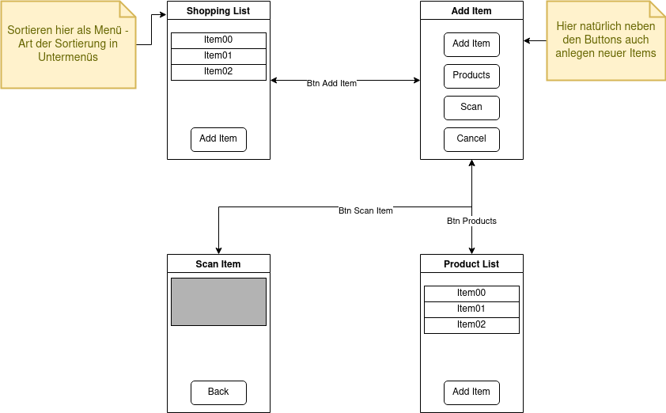

# SmartShoppingList

An Android shopping-list app with a local product catalogue, barcode scanning and route-aware list sorting.

SmartShoppingList lets users create products with a shelf location, add them to a shopping list and sort that list either alphabetically or by the shortest order through the supermarket. The route order is calculated with a custom genetic algorithm.

> **Status:** Student project

## Features

- Create, edit, search and remove products in a local catalogue.
- Add catalogued products directly to the shopping list and adjust their quantity.
- Scan EAN barcodes with the device camera and use the scanned code to find or create catalogued products.
- Sort the shopping list alphabetically or by shelf order.
- Persist products and shopping-list entries locally with Room.

## Route-aware sorting

Each product is assigned to one of nine shelf positions in a 3 x 3 supermarket grid. When sorting by distance, the app uses a genetic algorithm to find an order with a short total distance between consecutive shelf positions.

The editable source files are available as [shelf layout](Shelfs.drawio) and [activity flow](ActivityFlow.drawio).

## App flow



## Technology

- Java
- Android Views and XML layouts
- Android Gradle Plugin 7.1.3 / Gradle 7.2
- Room for local persistence

## Run locally

1. Install Android Studio.
2. Open the inner `SmartShoppingList/` directory - the one containing `settings.gradle`.
3. Let Android Studio finish the Gradle sync.
4. Select an emulator or an Android device running Android 9 (API 28) or newer.
5. Run the `app` configuration.

The barcode scanner needs camera permission. It is only requested when the scanner is opened.

## Build and test from the command line

Run these commands from the Android project directory:

```bash
./gradlew assembleDebug
./gradlew test
```

On Windows, use `gradlew.bat` instead.

## Project structure

```text
SmartShoppingList/
├── app/
│   └── src/main/java/
│       ├── core/  # Room database, models, sorting and genetic algorithm
│       ├── math/  # Vector and math helpers
│       └── ui/    # Activities and RecyclerView adapters
├── ActivityFlow.drawio
└── Shelfs.drawio
```
